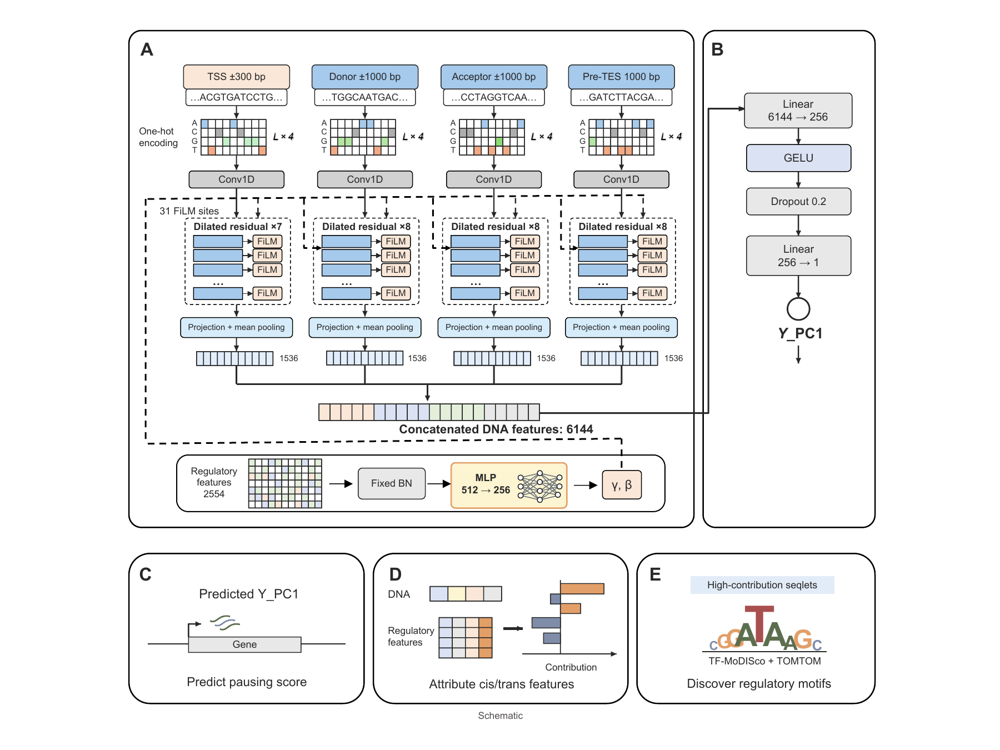
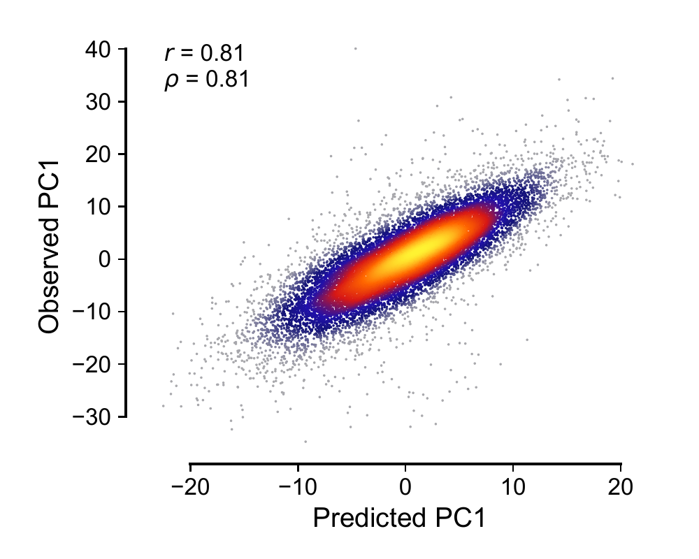

# PolII-FiLM

**Predicting human RNA polymerase II promoter-proximal pausing from DNA sequence and biochemical features.**

PolII-FiLM investigates how gene architecture, local DNA sequence and biochemical measurements relate to variation in promoter-proximal pausing across human genes. The project integrates **105 GRO-seq, PRO-seq and mNET-seq samples** to construct a composite gene-level pausing phenotype, represented by **signed PC1**, for **15,351 genes**.

The prediction task is to estimate this continuous phenotype from four transcription-oriented DNA regions and **2,554 biochemical features**. The model processes sequences around the transcription start site, first splice donor, first splice acceptor and upstream transcription end site with independent convolutional branches. Feature-wise linear modulation (**FiLM**) conditions the sequence representations on biochemical inputs before the regional representations are combined for regression.

This repository brings together the data-processing workflows, random forest analyses, trained FiLM models, interpretation results and plotting code used in the study. It supports reuse of the released inputs and checkpoints, prediction on compatible new inputs, and reproduction of the archived analyses and manuscript figures.

## Project overview

[](paper/figures/fig4/architecture/model_architecture_editable.pdf)

**Model and interpretation workflow.** Four DNA branches encode the TSS, first donor, first acceptor and upstream TES regions. Biochemical features condition these branches through FiLM; pooled regional representations are combined to predict signed PC1. Attribution and motif analyses characterize the learned sequence and biochemical associations. Click the image for the vector PDF.

<p align="center">
  <a href="paper/figures/fig4/oof/FiLM_OOF_correlation.pdf">
    
  </a>
</p>

**Held-out prediction.** Archived out-of-fold predictions for 15,351 genes, with five seeds averaged within each gene's held-out fold. The figure reports Pearson r = 0.81 and Spearman rho = 0.81. Input windows at overlapping genomic positions stay within the same fold; homology at distinct loci was not excluded. This preview displays the released result.

## Research workflow

1. **Construct the pausing phenotype.** Process nascent RNA sequencing data, calculate pausing indices and integrate the sample measurements into a gene-level target.
2. **Build and compare predictors.** Derive gene-architecture and sequence features, assemble biochemical measurements, and evaluate feature groups with random forests.
3. **Train the multimodal model.** Combine four DNA inputs with biochemical features through FiLM. Evaluate held-out genes using 10 folds and five seeds, keeping overlapping genomic input windows in the same fold.
4. **Characterize model behavior.** Analyze sequence and biochemical attributions, discover and annotate motifs, and quantify prediction changes through single-base substitutions and matched native-motif perturbations.
5. **Reproduce the reported analyses.** Use the saved predictions, complete intermediate results and figure-specific plotting inputs to regenerate summaries and figures, or run new computations in a separate output directory.

## Available resources

| Resource | Contents |
|---|---|
| Data processing | Sample manifests, assay-specific sequencing scripts, feature construction and processed inputs |
| Random forests | Gene-feature and biochemical-feature workflows, selection records, saved models and held-out predictions |
| PolII-FiLM | Architecture, training configuration, fold assignments, preprocessing parameters and pretrained checkpoints |
| Interpretation | Attribution, motif discovery and matching, single-base mutagenesis and matched motif-perturbation analyses |
| Figures | Frozen numerical inputs, plotting scripts, final PDFs and editable architecture artwork |

Start with [installation](#installation) and [resource downloads](#download-data-and-models). The [reproduction guide](docs/reproduction.md), [data format](docs/data_format.md), [model card](docs/model_card.md), [figure map](docs/figure_map.md) and [archive scope](docs/analysis_scope.md) describe the supported workflows and their interpretation.

## Repository layout

```text
polii_film/       Portable model loading, prediction and evaluation
configs/          Model, figure and downloadable-data indexes
scripts/          Data preparation, training and figure/perturbation entry points
pretrained/       Links to released model resources
model/            Model architecture, original training code and RF workflows
data/             Feature construction and sequencing-processing code
paper/analysis/   Attribution, motif, mutagenesis and statistical-analysis code
paper/figures/    Frozen plotting data, figure scripts and figure files
docs/             Formats, model card, figure mapping and reproduction instructions
```

Source code and manuscript figure resources are tracked in Git. Large model, reference, processed-data and analysis-result files are distributed in the [v1.0.0 data release](https://github.com/HongTao017/PolII-FiLM/releases/tag/v1.0.0). The download script maps archived resource names to the current English layout. See the [reproduction guide](docs/reproduction.md) for metadata compatibility and source-revision records.

## Model

Four independent DNA branches receive transcription-oriented one-hot sequences:

| Region | Window | Length |
|---|---|---:|
| TSS | −300 to +300 bp | 600 bp |
| First splice donor | −1,000 to +1,000 bp | 2,000 bp |
| First splice acceptor | −1,000 to +1,000 bp | 2,000 bp |
| TES upstream | −1,000 to 0 bp | 1,000 bp |

The **2,554 biochemical features** comprise ChIP-seq (2,284), eCLIP (206), ChIA-PET (50), DamID (10) and ATAC-seq (4). FiLM modulates dilated convolutional features. Regional representations are pooled and concatenated to predict a single **signed-PC1 value per gene**.

The released model is **`model_film`**, with dropout 0.2. Its archive contains 10 folds × five seeds, with best checkpoints, preprocessing parameters and training records. Each gene's out-of-fold (OOF) prediction uses its held-out fold and averages five predictions in original PC1 units. Different folds share no genomic positions in the four input windows; homology at distinct loci was not excluded.

## Installation

Use Python 3.10+ for model work. Install a PyTorch build appropriate for your CUDA version, then install the package:

```bash
git clone https://github.com/HongTao017/PolII-FiLM.git
cd PolII-FiLM
python -m venv .venv-model
source .venv-model/bin/activate
pip install torch==2.6.0 --index-url https://download.pytorch.org/whl/cu124
pip install -e '.[genomics]'
```

For plotting, use a separate Python 3.11+ environment:

```bash
python3.11 -m venv .venv-figures
.venv-figures/bin/python -m pip install -r requirements-figures.txt
```

## Download data and models

```bash
# List packages without downloading
python scripts/download_resources.py --list

# Model checkpoints and inputs; reference inputs include the bundled FASTA/GTF
python scripts/download_resources.py --group model_film --group reference_inputs

# Complete published processed-data / model / analysis-result archive
python scripts/download_resources.py --all
```

Packages are split into bounded release assets. The script downloads parts in order, checks their transfer SHA256 values, and extracts them into the repository. Downloads can resume from completed parts. Published groups include `model_film`, `rf_models`, `reference_inputs`, `feature_data`, `sequencing_processed`, `interpretation`.

## Evaluate and predict

```bash
# Aggregate the saved OOF predictions
python -m polii_film.cli evaluate --saved-predictions \
  --output-dir outputs/saved_oof

# Re-run checkpoint inference on all held-out genes
CUDA_VISIBLE_DEVICES=0 python -m polii_film.cli evaluate \
  --device cuda:0 --precision bfloat16 --batch-size 32 \
  --output-dir outputs/fresh_oof

# Predict new data in the released format
python -m polii_film.cli predict --data-dir /path/to/input \
  --fold 1 --device cuda:0 --output-dir outputs/new_predictions
```

Feature order, training-fold preprocessing and output scaling must be preserved. See [data format](docs/data_format.md) and [model card](docs/model_card.md).

## Prepare data and train

```bash
# Re-extract DNA from the released reference and saved coordinates
python scripts/prepare_data.py --output-dir outputs/prepared_inputs

# Original training protocol, with outputs redirected to a new directory
CUDA_VISIBLE_DEVICES=0 python scripts/train.py \
  --output-dir outputs/new_training --fold 1 --replicate 1
```

Run folds 1–10 and replicates 1–5 explicitly to repeat all training runs. The adapter preserves the original architecture, hyperparameters and coordinate-disjoint assignments. Historical source configurations are retained for provenance; use the portable entry points instead of the historical launch/controller scripts.

Random forest code, feature-selection records and model resources are under `model/forse_gene/` and `paper/analysis/rf_biochemical/`. Their historical directory names and feature orders are retained. The release covers the archived manuscript workflows; it is not an inventory of every exploratory RF experiment ever performed.

## Reproduce figures and perturbation analyses

```bash
# Supply locally licensed Arial fonts for the original typography
python scripts/configure_fonts.py --arial-dir /path/to/Arial/fonts

# Plot all indexed figures into a new output directory
.venv-figures/bin/python scripts/reproduce_figures.py \
  --output-dir outputs/redrawn_figures

# Recalculate statistics from released complete intermediate results
.venv-figures/bin/python scripts/recompute_statistics.py all_base_ism \
  --output-dir outputs/ism_statistics
.venv-figures/bin/python scripts/recompute_statistics.py native_motif \
  --output-dir outputs/motif_statistics

# Re-run all valid single-base substitutions for a selected fold
CUDA_VISIBLE_DEVICES=0 python scripts/run_allbase_ism.py \
  --output-dir outputs/new_ism --fold 1 --device cuda:0
```

The [figure map](docs/figure_map.md) maps historical folder names to current manuscript panels. Numeric plotting resources are included. Microsoft Arial font binaries and runtime environments are not distributed; the font setup script copies fonts supplied by the user. Figure 4's architecture diagram is available as an editable presentation/PDF. Figure S2 is not included in this snapshot.

## Native BAM-counting helpers

The model, training, prediction and main plotting workflows are implemented in Python. Two small C++/HTSlib helpers are retained for regional BAM counting used in CPM calculations:

- `paper/analysis/chip_cpm/count_fragments.cpp`: ChIP-seq fragment counting.
- `paper/analysis/eclip_cpm/count_eclip.cpp`: eCLIP alignment counting; a provenance copy is also retained with the corresponding figure.

These helpers are used when rebuilding regional counts from BAM files. Plotting the released frozen numeric data does not require recompiling them. Third-party PyMuPDF QA dependencies are installed through `requirements-figures.txt`; their bundled headers and library sources are excluded from the Git source tree.

## Data provenance and scope

The release includes processed sequencing results, sample manifests, feature matrices, reference inputs, original model records and completed interpretation results. Raw FASTQ/BAM/SRA files are not duplicated; public accession/download information and processing scripts are retained. Repeating alignment or motif discovery requires the corresponding tools and source inputs. See [analysis scope](docs/analysis_scope.md).

Earlier server-side checks and results are recorded as provenance. No new scientific validation or model training was performed for this GitHub publication.

## Attribution and license

Required third-party copyright, attribution and license terms are preserved in [LICENSE.model](LICENSE.model), [NOTICE](NOTICE), and the corresponding source directories. Data retain their original source terms.
