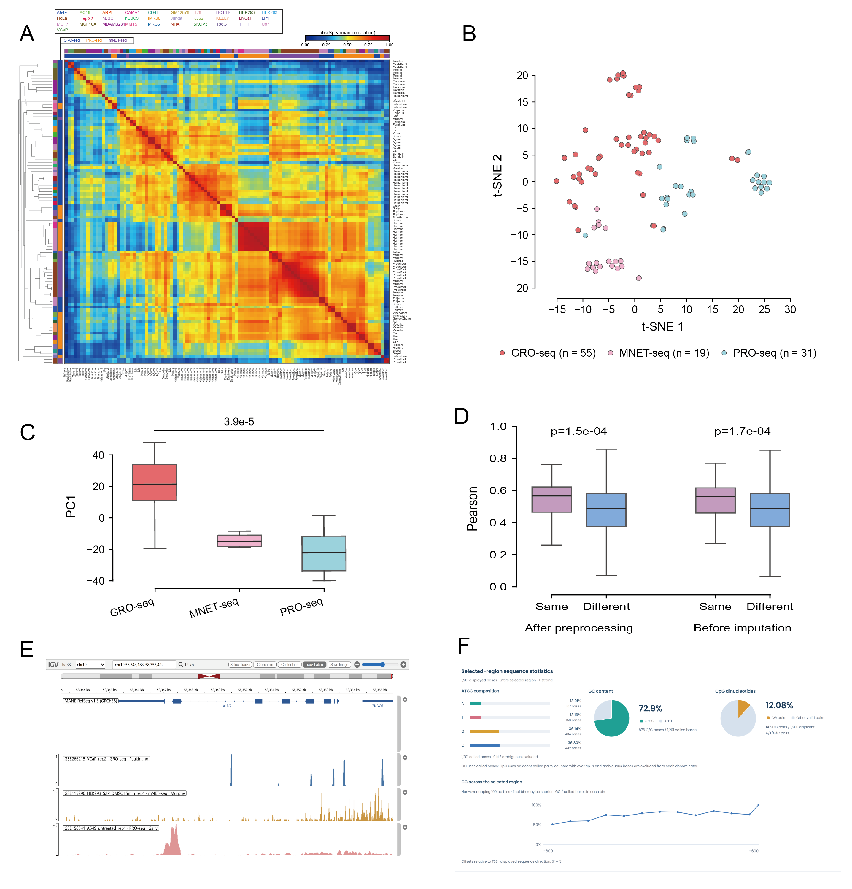
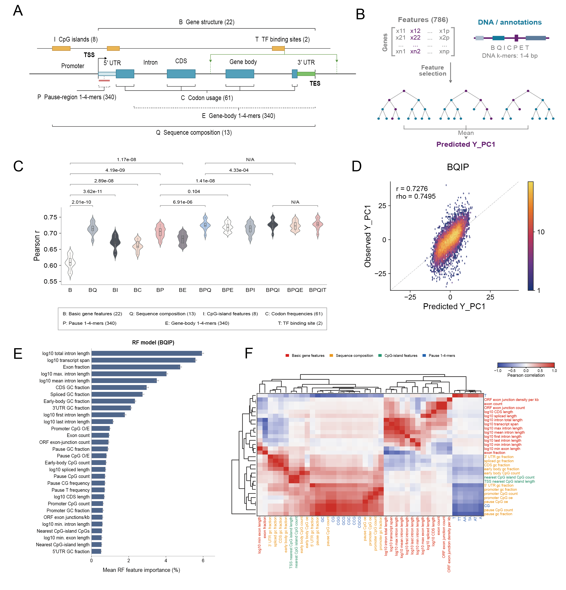
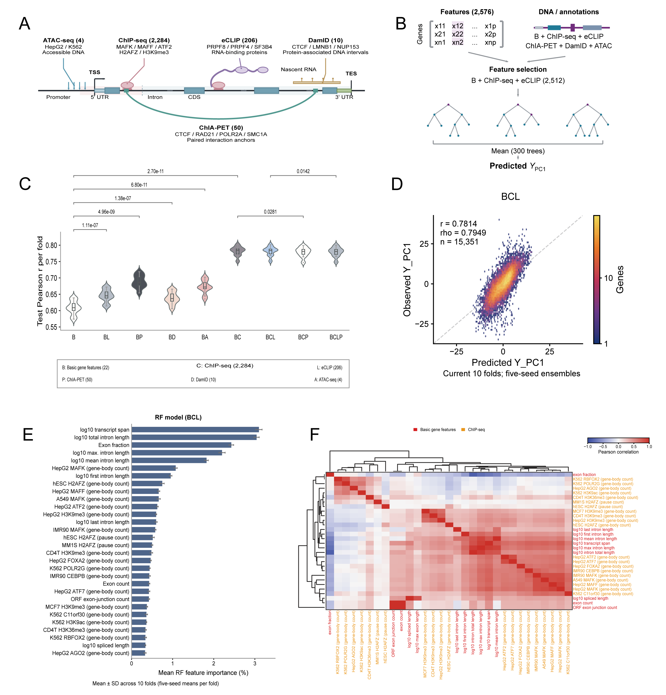
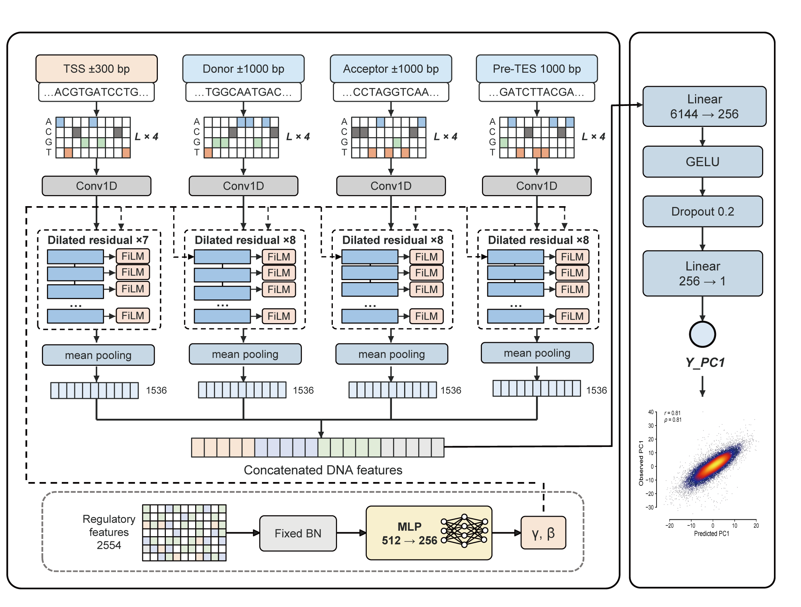
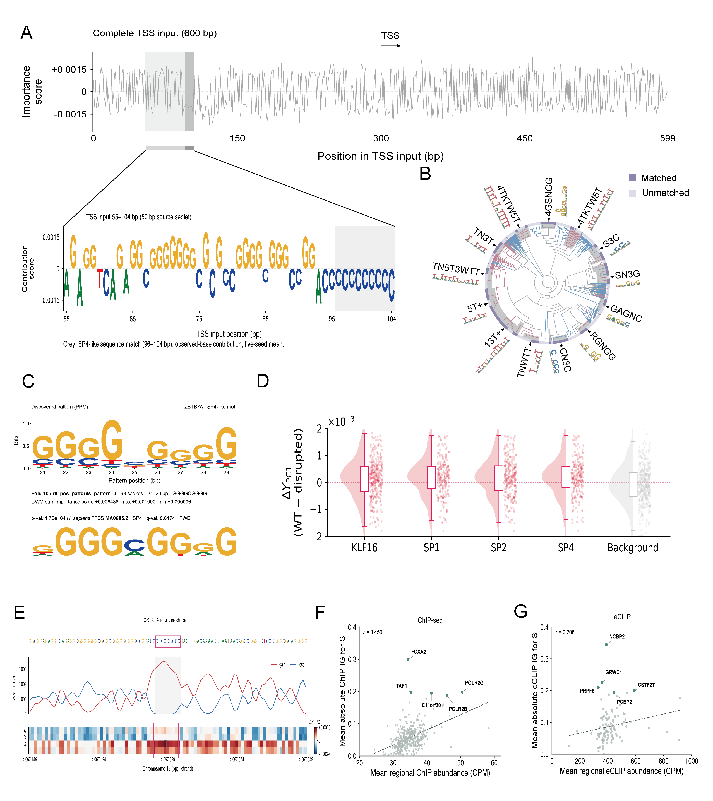

# PolII-FiLM / PFNet

**DNA sequence and biochemical features predict promoter-proximal RNA polymerase II pausing across human genes.**

This project investigates how gene architecture, DNA sequence and biochemical context relate to gene-level differences in human RNA polymerase II (Pol II) promoter-proximal pausing. It integrates **105 GRO-seq, PRO-seq and mNET-seq samples from 41 GEO series**, constructs a composite pausing phenotype for **15,351 genes**, and combines random forest analyses with **PFNet**, a multimodal neural network.

PFNet is the model name used in the manuscript. The repository, Python package (`polii_film`) and released model directory (`model_film`) retain their existing names for use with the download and reproduction commands below.

The figures below follow the manuscript's progression: establish the pausing compendium, assess gene-derived predictors, assess biochemical predictors, integrate both inputs in PFNet, and interpret the resulting predictions. Each image is extracted directly from the supplied manuscript; click it to inspect the full-resolution figure.

**Explore the study:** [Figure 1: data and browser](#figure-1) | [Figure 2: gene-derived predictors](#figure-2) | [Figure 3: biochemical predictors](#figure-3) | [Figure 4: PFNet](#figure-4) | [Figure 5: interpretation](#figure-5)

<a id="figure-1"></a>

## Figure 1 - The pausing compendium and PuasedDB

[](docs/assets/manuscript_figure_1.png)

**Cross-study consistency and interactive exploration.** The compendium contains 55 GRO-seq, 31 PRO-seq and 19 mNET-seq samples. **Panels A-C** show sample correlations, a t-SNE representation and assay-associated differences. **Panel D** compares samples from different studies: profiles are more similar for the same cell type than for different cell types, both after preprocessing and before imputation. This supports a cell-type-associated component alongside assay and study variation.

**Panels E-F** connect these measurements to interactive exploration in **PuasedDB**: nascent-transcription tracks at the A1BG locus and sequence-composition summaries around the SAMD11 TSS. For predictive modeling, standardized pausing measurements are imputed and quantile-normalized, then summarized by gene-level PC1. This composite target explains **53.2%** of between-gene variation and is oriented so that higher scores correspond to higher pausing indices. It summarizes pausing measurements rather than directly measuring pause duration.

<a id="figure-2"></a>

## Figure 2 - Gene architecture and sequence predictors

[](docs/assets/manuscript_figure_2.png)

**Predictive information in gene structure and sequence.** **Panels A-B** define 786 candidate features in seven groups and the random forest workflow. The groups cover gene architecture, sequence composition, CpG islands, codon usage, pausing-region k-mers, gene-body k-mers and predicted CTCF-binding features.

**Panel C** compares feature combinations on identical ten-fold splits. Gene architecture alone gives a mean test-fold Pearson correlation of **0.609**; adding pausing-region k-mers, sequence composition and CpG-island features raises it to approximately **0.727**. The selected **383-feature** model produces pooled out-of-fold predictions with **Pearson r = 0.728** and **Spearman rho = 0.750** (**panel D**). **Panels E-F** prioritize total intron length, transcript span and exon fraction, while showing correlations among informative predictors. Impurity importance describes predictive use and has no activation/repression direction. Feature-selection comparisons are exploratory.

<a id="figure-3"></a>

## Figure 3 - Biochemical predictors

[](docs/assets/manuscript_figure_3.png)

**Predictive information added by biochemical measurements.** **Panels A-B** introduce five biochemical feature classes: ChIP-seq, eCLIP, ChIA-PET, DamID and ATAC-seq. Together with 22 baseline architecture features, these yield **2,576 candidate predictors**. The selected combination contains **22 architecture + 2,284 ChIP-seq + 206 eCLIP features**, totaling **2,512**.

**Panel C** shows that ChIP-seq provides the largest predictive gain among the tested biochemical groups. The selected model reaches pooled out-of-fold **Pearson r = 0.781** and **Spearman rho = 0.795** (**panel D**). **Panels E-F** show that gene architecture remains informative and highlight biochemical predictors including gene-body MAFK occupancy. Strong correlations among related measurements mean that feature rankings should be interpreted as predictive associations rather than independent causal effects.

<a id="figure-4"></a>

## Figure 4 - PFNet integrates DNA and biochemical context

[](docs/assets/manuscript_figure_4.png)

**Sequence learning conditioned on biochemical context.** PFNet encodes four transcription-oriented DNA windows independently: **TSS +/-300 bp**, **first donor +/-1,000 bp**, **first acceptor +/-1,000 bp**, and **1,000 bp upstream of TES**. These inputs total **5,600 bp**. Convolutional and dilated residual blocks encode each region, while an MLP transforms **2,554 biochemical features** into FiLM scale and shift parameters that modulate sequence channels.

Regional vectors are pooled, concatenated and passed to a regression head to predict the composite PC1 score. Ten-fold evaluation groups genes with overlapping DNA input windows into the same fold. Five-seed held-out predictions for **15,351 genes** achieve **Pearson r = 0.81**, shown in the lower-right inset. This is gene-level prediction of a composite phenotype; the fold constraint excludes shared genomic input positions but does not exclude sequence homology at distinct loci.

<a id="figure-5"></a>

## Figure 5 - Sequence and biochemical interpretation

[](docs/assets/manuscript_figure_5.png)

**Candidate sequence elements and biochemical contributors.** **Panel A** displays signed DeepLIFT contributions across the ZBTB7A TSS input and enlarges a high-contribution segment. **Panel B** summarizes **314 discovered sequence patterns**, including **44** with known-motif matches. **Panel C** aligns the pattern containing the ZBTB7A seqlet with an SP4-like reference motif. Motif similarity nominates candidate factors; it does not identify a uniquely bound protein.

**Panel D** tests native motif organization using composition-preserving core shuffles and matched background perturbations. In the manuscript's pooled positive-annotation analyses, KLF16-, SP1-, SP2- and SP4-like groups show greater reductions in predicted PC1 than their controls, with Holm-adjusted P values of **0.0061-0.0302** across 35 comparisons. These annotation-level groups can share underlying patterns and do not establish that every matched pattern is independently significant. Here, the plotted effect is **original minus disrupted PC1**: a positive value means disruption lowers the prediction.

**Panel E** resolves substitution effects across a **101-bp** window around the ZBTB7A SP4-like site. It uses the opposite sign convention, **mutant minus original PC1**, averaged across five models. A highlighted C-to-G substitution removes the FIMO match at its original position. **Panels F-G** relate regional signal abundance to mean absolute integrated-gradients attribution: **r = 0.450** for 364 ChIP-profiled factors and **r = 0.206** for 103 eCLIP-profiled proteins. Together, these analyses prioritize candidate elements and factors for experimental follow-up; computational effects and attributions do not demonstrate causal regulation.

## From figures to reusable resources

The figure tour follows the supplied manuscript. The repository provides the archived processing, modeling and plotting resources described below; historical figure folders can retain earlier display variants. Use the [figure map](docs/figure_map.md) to locate panel packages and the [archive scope](docs/analysis_scope.md) to check what is distributed. The homepage images and their source-page records are listed in [figure provenance](docs/assets/manuscript_figures.json).

## Available resources

| Resource | Contents |
|---|---|
| Data processing | Sample manifests, assay-specific sequencing scripts, feature construction and processed inputs |
| Random forests | Gene-feature and biochemical-feature workflows, selection records, saved models and held-out predictions |
| PFNet / PolII-FiLM | Architecture, training configuration, fold assignments, preprocessing parameters and pretrained checkpoints |
| Interpretation | Attribution, motif discovery and matching, single-base mutagenesis and matched motif-perturbation analyses |
| Figures | Frozen numerical inputs, plotting scripts, final PDFs and editable architecture artwork |

Start with [installation](#installation) and [resource downloads](#download-data-and-models). The [reproduction guide](docs/reproduction.md), [data format](docs/data_format.md), [model card](docs/model_card.md), [figure map](docs/figure_map.md) and [archive scope](docs/analysis_scope.md) describe the supported workflows and their interpretation.

## Repository layout

```text
polii_film/       Portable model loading, prediction and evaluation
configs/          Model, figure and downloadable-data indexes
scripts/          Data preparation, training and figure/perturbation entry points
pretrained/       Links to released model resources
model/            Model architecture, original training code and RF workflows
data/             Feature construction and sequencing-processing code
paper/analysis/   Attribution, motif, mutagenesis and statistical-analysis code
paper/figures/    Frozen plotting data, figure scripts and figure files
docs/             Formats, model card, figure mapping and reproduction instructions
```

Source code and manuscript figure resources are tracked in Git. Large model, reference, processed-data and analysis-result files are distributed in the [v1.0.0 data release](https://github.com/HongTao017/PolII-FiLM/releases/tag/v1.0.0). The download script maps archived resource names to the current English layout. See the [reproduction guide](docs/reproduction.md) for metadata compatibility and source-revision records.

## Model

Four independent DNA branches receive transcription-oriented one-hot sequences:

| Region | Window | Length |
|---|---|---:|
| TSS | −300 to +300 bp | 600 bp |
| First splice donor | −1,000 to +1,000 bp | 2,000 bp |
| First splice acceptor | −1,000 to +1,000 bp | 2,000 bp |
| TES upstream | −1,000 to 0 bp | 1,000 bp |

The **2,554 biochemical features** comprise ChIP-seq (2,284), eCLIP (206), ChIA-PET (50), DamID (10) and ATAC-seq (4). FiLM modulates dilated convolutional features. Regional representations are pooled and concatenated to predict a single **signed-PC1 value per gene**.

The released model is **`model_film`**, with dropout 0.2. Its archive contains 10 folds × five seeds, with best checkpoints, preprocessing parameters and training records. Each gene's out-of-fold (OOF) prediction uses its held-out fold and averages five predictions in original PC1 units. Different folds share no genomic positions in the four input windows; homology at distinct loci was not excluded.

## Installation

Use Python 3.10+ for model work. Install a PyTorch build appropriate for your CUDA version, then install the package:

```bash
git clone https://github.com/HongTao017/PolII-FiLM.git
cd PolII-FiLM
python -m venv .venv-model
source .venv-model/bin/activate
pip install torch==2.6.0 --index-url https://download.pytorch.org/whl/cu124
pip install -e '.[genomics]'
```

For plotting, use a separate Python 3.11+ environment:

```bash
python3.11 -m venv .venv-figures
.venv-figures/bin/python -m pip install -r requirements-figures.txt
```

## Download data and models

```bash
# List packages without downloading
python scripts/download_resources.py --list

# Model checkpoints and inputs; reference inputs include the bundled FASTA/GTF
python scripts/download_resources.py --group model_film --group reference_inputs

# Complete published processed-data / model / analysis-result archive
python scripts/download_resources.py --all
```

Packages are split into bounded release assets. The script downloads parts in order, checks their transfer SHA256 values, and extracts them into the repository. Downloads can resume from completed parts. Published groups include `model_film`, `rf_models`, `reference_inputs`, `feature_data`, `sequencing_processed`, `interpretation`.

## Evaluate and predict

```bash
# Aggregate the saved OOF predictions
python -m polii_film.cli evaluate --saved-predictions \
  --output-dir outputs/saved_oof

# Re-run checkpoint inference on all held-out genes
CUDA_VISIBLE_DEVICES=0 python -m polii_film.cli evaluate \
  --device cuda:0 --precision bfloat16 --batch-size 32 \
  --output-dir outputs/fresh_oof

# Predict new data in the released format
python -m polii_film.cli predict --data-dir /path/to/input \
  --fold 1 --device cuda:0 --output-dir outputs/new_predictions
```

Feature order, training-fold preprocessing and output scaling must be preserved. See [data format](docs/data_format.md) and [model card](docs/model_card.md).

## Prepare data and train

```bash
# Re-extract DNA from the released reference and saved coordinates
python scripts/prepare_data.py --output-dir outputs/prepared_inputs

# Original training protocol, with outputs redirected to a new directory
CUDA_VISIBLE_DEVICES=0 python scripts/train.py \
  --output-dir outputs/new_training --fold 1 --replicate 1
```

Run folds 1–10 and replicates 1–5 explicitly to repeat all training runs. The adapter preserves the original architecture, hyperparameters and coordinate-disjoint assignments. Historical source configurations are retained for provenance; use the portable entry points instead of the historical launch/controller scripts.

Random forest code, feature-selection records and model resources are under `model/forse_gene/` and `paper/analysis/rf_biochemical/`. Their historical directory names and feature orders are retained. The release covers the archived manuscript workflows; it is not an inventory of every exploratory RF experiment ever performed.

## Reproduce figures and perturbation analyses

```bash
# Supply locally licensed Arial fonts for the original typography
python scripts/configure_fonts.py --arial-dir /path/to/Arial/fonts

# Plot all indexed figures into a new output directory
.venv-figures/bin/python scripts/reproduce_figures.py \
  --output-dir outputs/redrawn_figures

# Recalculate statistics from released complete intermediate results
.venv-figures/bin/python scripts/recompute_statistics.py all_base_ism \
  --output-dir outputs/ism_statistics
.venv-figures/bin/python scripts/recompute_statistics.py native_motif \
  --output-dir outputs/motif_statistics

# Re-run all valid single-base substitutions for a selected fold
CUDA_VISIBLE_DEVICES=0 python scripts/run_allbase_ism.py \
  --output-dir outputs/new_ism --fold 1 --device cuda:0
```

The [figure map](docs/figure_map.md) maps historical folder names to current manuscript panels. Numeric plotting resources are included. Microsoft Arial font binaries and runtime environments are not distributed; the font setup script copies fonts supplied by the user. Figure 4's architecture diagram is available as an editable presentation/PDF. Figure S2 is not included in this snapshot.

## Native BAM-counting helpers

The model, training, prediction and main plotting workflows are implemented in Python. Two small C++/HTSlib helpers are retained for regional BAM counting used in CPM calculations:

- `paper/analysis/chip_cpm/count_fragments.cpp`: ChIP-seq fragment counting.
- `paper/analysis/eclip_cpm/count_eclip.cpp`: eCLIP alignment counting; a provenance copy is also retained with the corresponding figure.

These helpers are used when rebuilding regional counts from BAM files. Plotting the released frozen numeric data does not require recompiling them. Third-party PyMuPDF QA dependencies are installed through `requirements-figures.txt`; their bundled headers and library sources are excluded from the Git source tree.

## Data provenance and scope

The release includes processed sequencing results, sample manifests, feature matrices, reference inputs, original model records and completed interpretation results. Raw FASTQ/BAM/SRA files are not duplicated; public accession/download information and processing scripts are retained. Repeating alignment or motif discovery requires the corresponding tools and source inputs. See [analysis scope](docs/analysis_scope.md).

Earlier server-side checks and results are recorded as provenance. No new scientific validation or model training was performed for this GitHub publication.

## Attribution and license

Required third-party copyright, attribution and license terms are preserved in [LICENSE.model](LICENSE.model), [NOTICE](NOTICE), and the corresponding source directories. Data retain their original source terms.
